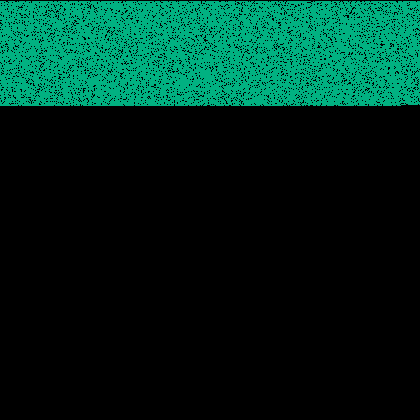
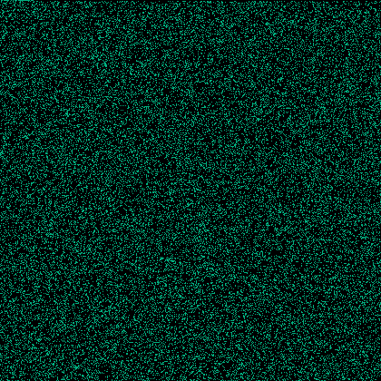

# hidew-stego

**Password-scattered LSB steganography for PNG images.**

Hide text inside an ordinary photo. The image looks unchanged, and only the right password can find the hidden text.

| Original | With a hidden message |
| :---: | :---: |
|  |  |
| | PSNR **85.1 dB** · max change **±1 / 255** |

## How it works

1. **Scatter.** The password is turned into a seed by **Argon2id**. A **Fisher–Yates shuffle** driven by that seed picks which pixels carry the text.
2. **Embed.** The original text is written bit by bit into the **least-significant bit** of each chosen pixel's red, green and blue values. No value changes by more than 1.

The text is stored as-is, not encrypted. Without the password, nobody knows which pixels hold it. A small header in the first pixels stores the salt and Argon2 settings, and a CRC-32 checksum detects a wrong password or a modified image.

## Why scatter the bits?

Writing bits into consecutive pixels is easy to detect. The demo hides the same data both ways and runs the classic **chi-square LSB test**:

| Sequential LSB | Scattered |
| :---: | :---: |
|  |  |
| **1.000**: detected | **0.000**: looks like the original |

*Green = changed pixels.*

## Quick start

```bash
python -m venv .venv
source .venv/bin/activate        # Windows: .venv\Scripts\activate
pip install -e ".[dev]"

python examples/demo.py          # walkthrough, writes images to examples/output/
pytest                           # tests
```

### Command line

```bash
hidew-stego hide photo.png secret.png -m "my message"   # prompts for a password
hidew-stego reveal secret.png
hidew-stego inspect secret.png                          # capacity and header
hidew-stego analyze photo.png secret.png --out-dir out/ # PSNR, chi-square, diff map
```

### Python

```python
from hidew_stego import hide, reveal

hide("photo.png", b"my message", "password").save("secret.png")
reveal("secret.png", "password")   # b'my message'
```

## Project layout

```
hidew_stego/
  keys.py          password → pixel-order seed (Argon2id)
  permutation.py   key-derived pixel order
  lsb.py           LSB read/write
  stego.py         hide() / reveal()
  analysis.py      PSNR, bit planes, chi-square test
  cli.py           command line
examples/demo.py   end-to-end demo
tests/             tests
```

## Notes

- Keep the output as **PNG**. JPEG, resizing or re-compression destroy the hidden data.
- An 800×800 image holds about 234 KB.
